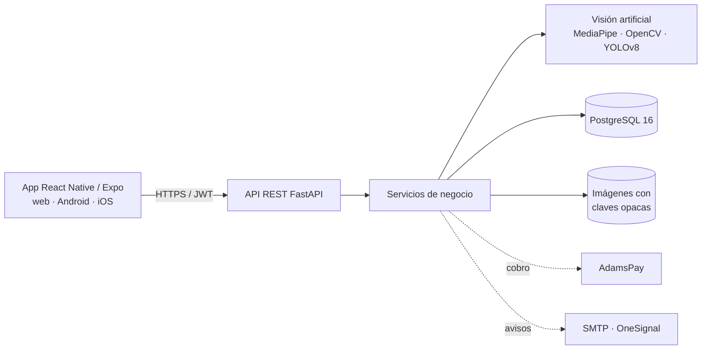

# DermaSeguimiento


Aplicación para el seguimiento fotográfico dermatológico en consultorios independientes. Alinea
automáticamente las fotografías de dos consultas a partir de puntos faciales y cuantifica los cambios de
color de la piel, manchas, textura, ojeras y lesiones de acné, para que el profesional compare con datos
objetivos y entregue al paciente un informe de su evolución.

Proyecto de tesis de Ingeniería Informática de la Universidad de la Integración de las Américas (UNIDA),
Asunción, Paraguay, 2026: *Diseño e implementación de aplicación móvil con OpenCV para trazabilidad del
cuidado dermatológico en consultorios independientes de Asunción, 2026*.

> Los resultados son de apoyo a la documentación clínica y **no constituyen un diagnóstico**. La
> interpretación corresponde siempre al profesional médico.

## Contenido

- [Funcionalidades](#funcionalidades)
- [Identidad de la aplicación](#identidad-de-la-aplicación)
- [Arquitectura](#arquitectura)
- [Tecnologías](#tecnologías)
- [Estructura del repositorio](#estructura-del-repositorio)
- [Instalación](#instalación)
- [Configuración segura](#configuración-segura)
- [Integraciones externas](#integraciones-externas)
- [Modelo de detección de lesiones](#modelo-de-detección-de-lesiones)
- [Despliegue en producción](#despliegue-en-producción)
- [Respaldo y restauración](#respaldo-y-restauración)
- [Pruebas y verificación](#pruebas-y-verificación)
- [Prueba de carga](#prueba-de-carga)
- [Resultados de la validación técnica](#resultados-de-la-validación-técnica)
- [Estado del desarrollo](#estado-del-desarrollo)
- [Autora](#autora)

## Funcionalidades

- **Gestión clínica:** registro y edición de pacientes con consentimiento informado digital (revocable),
  historial cronológico, baja lógica con motivo y reactivación, y control de ediciones simultáneas.
- **Captura guiada:** óvalo y silueta de la consulta anterior en pantalla; control de luz, enfoque y encuadre
  antes de procesar.
- **Procesamiento de imágenes:** detección de 478 puntos faciales (MediaPipe), alineación afín (OpenCV),
  color en CIE Lab y Delta E por zona, SSIM, manchas, textura (filtro de Frangi), ojeras y detección de
  lesiones de acné con YOLOv8.
- **Resultados:** comparador antes/después con capas y modo parpadeo, resumen en palabras de los cambios,
  gráfico de evolución por indicador y valoración clínica (IGA, mMASI).
- **Informes:** informe de evolución en PDF para el paciente y exportación en CSV.
- **Suscripciones:** plan gratuito y Premium (mensual o anual), cobro con AdamsPay, recibos y avisos de
  vencimiento.
- **Seguridad:** contraseñas con bcrypt, verificación de correo, sesiones revocables, bloqueo por intentos
  fallidos, control de acceso por rol y por propiedad de los datos y auditoría inmutable.
- **Administración:** usuarios y roles, suscripciones, anulación de comprobantes, recuperación de pacientes
  dados de baja, auditoría con filtros, configuración y plantillas de correo y resultados de la escala SUS.

## Identidad de la aplicación

- Nombre visible: `DermaSeguimiento`
- Identificador Android e iOS: `py.dermaseguimiento.app`
- Versión: `1.0.0`
- Plataformas: navegador (web), Android e iOS, a partir del mismo código

## Arquitectura



El procesamiento de imágenes se ejecuta en el servidor; ninguna imagen se envía a servicios externos.

## Tecnologías

| Componente | Tecnología | Versión |
|---|---|---|
| Backend | Python, FastAPI, SQLAlchemy, Alembic, Pydantic | 3.12 · 0.141 · 2.0 · 1.20 · 2.13 |
| Base de datos | PostgreSQL | 16 |
| Visión artificial | OpenCV, MediaPipe Face Landmarker, scikit-image | 5.0 · 1.0 · 0.26 |
| Detección de lesiones | YOLOv8n exportado a ONNX, entrenado con ACNE04 | 8.x |
| Aplicación | React Native, Expo, expo-router | 0.81 · SDK 54 · 6 |
| Informes | reportlab (PDF) | 5.0 |
| Contenedores | Docker y Docker Compose | — |
| Integración continua | GitHub Actions | — |

## Estructura del repositorio

```
Tesis-dermaseguimiento/
├── backend/                  API FastAPI
│   ├── main.py               arranque, manejo de errores y cabeceras de seguridad
│   ├── core/                 configuración, seguridad y sesiones, políticas, límites
│   ├── models/               tablas (usuarios, pacientes, seguimientos, auditoría, pagos…)
│   ├── schemas/              validación de entrada y salida
│   ├── routers/              endpoints por módulo
│   ├── services/             lógica de negocio, visión artificial, pagos, correo y push
│   ├── migrations/           migraciones de Alembic (esquema versionado)
│   ├── scripts/              datos iniciales, respaldo y restauración, validación, piloto y mediciones
│   ├── pruebas_carga/        prueba de carga con Locust
│   └── tests/                pruebas automáticas (pytest)
├── dermaseguimiento/         aplicación React Native + Expo Router
├── entrenamiento_yolo/       preparación de ACNE04, evaluación y exportación del modelo a ONNX
├── .github/workflows/        integración continua
└── docker-compose.yml        base de datos y API en contenedores
```

## Instalación

### Requisitos previos

| Herramienta | Versión |
|---|---|
| Python | 3.12 |
| PostgreSQL | 16 |
| Node.js y npm | 20 o superior |
| Android Studio (opcional, app nativa) | con Java 17 |

### 1. Backend

```bash
git clone https://github.com/lujangxnzalezz1/Tesis-dermaseguimiento.git
cd Tesis-dermaseguimiento/backend
python3.12 -m venv venv && source venv/bin/activate      # Windows: venv\Scripts\activate
pip install -r requirements-dev.txt
createdb dermaseguimiento
cp .env.example .env                                     # completar las variables (ver Configuración segura)
alembic upgrade head                                     # crea el esquema
python -m scripts.seed                                   # planes, plantillas de correo y administrador
uvicorn main:app --reload
```

- Documentación interactiva: http://127.0.0.1:8000/docs (Swagger) y http://127.0.0.1:8000/redoc
- Chequeo de disponibilidad: http://127.0.0.1:8000/salud

El modelo de lesiones se copia en `backend/modelos/acne_yolov8n.onnx` (ver
[Modelo de detección de lesiones](#modelo-de-detección-de-lesiones)). Es opcional: sin él, el sistema
funciona y omite ese análisis.

### 2. Aplicación (navegador)

```bash
cd dermaseguimiento
npm install
cp .env.example .env      # EXPO_PUBLIC_API_URL: dirección del backend
npx expo start --web
```

### 3. Aplicación nativa en Android

```bash
cd dermaseguimiento
npx expo run:android      # requiere Android Studio y un emulador o un celular conectado
```

Desde el emulador, el backend se alcanza con `adb reverse tcp:8000 tcp:8000` o con
`EXPO_PUBLIC_API_URL=http://10.0.2.2:8000`. Desde un celular físico, se usa la IP local de la computadora.

### 4. Contenedores (opcional)

```bash
cp backend/.env.example backend/.env
POSTGRES_PASSWORD=una-clave-fuerte docker compose up --build
```

Levanta tres servicios: `db` (PostgreSQL 16), `backend` (aplica las migraciones, carga los datos iniciales y
arranca la API en el puerto 8000) y `recordatorios` (genera los avisos de vencimiento una vez por día).

## Configuración segura

El repositorio no contiene credenciales. Toda la configuración se define con variables de entorno en
`backend/.env` (excluido de Git), a partir de `backend/.env.example`.

| Variable | Uso |
|---|---|
| `DATABASE_URL` | Conexión a PostgreSQL |
| `SECRET_KEY` | Firma de los tokens de sesión |
| `PASARELA` | `adamspay` o `sandbox` (pasarela interna de pruebas) |
| `ADAMSPAY_API_URL`, `ADAMSPAY_API_KEY` | Ambiente y clave de la aplicación de AdamsPay |
| `PASARELA_WEBHOOK_SECRET` | Firma de las notificaciones de la pasarela interna |
| `SMTP_ENABLED`, `SMTP_HOST`, `SMTP_USER`, `SMTP_PASSWORD` | Correo de verificación, recuperación y avisos |
| `VERIFICAR_EMAIL_REGISTRO` | Exige confirmar el correo antes de iniciar sesión |
| `TRIAL_DAYS`, `AVISOS_DIAS_ANTES` | Días de prueba Premium y avisos de vencimiento |
| `ONESIGNAL_APP_ID`, `ONESIGNAL_REST_API_KEY` | Notificaciones push (opcional) |
| `ADMIN_EMAIL`, `ADMIN_PASSWORD` | Administrador inicial |

Para generar claves: `python -c "import secrets; print(secrets.token_urlsafe(48))"`.

## Integraciones externas

- **AdamsPay** (pasarela paraguaya): el sistema crea el cobro, redirige a su página de pago y confirma el
  resultado consultando el estado con la clave de la aplicación. Un pago se aprueba solo si el monto y la
  moneda coinciden con la operación. En el ambiente de pruebas se usa el simulador de AdamsPay.
- **Correo SMTP:** verificación de cuenta, recuperación de contraseña y avisos de pago y vencimiento. Sin
  SMTP configurado, los enlaces se muestran en la consola del servidor. Los textos de los correos se editan
  desde *Administración → Correo*.
- **OneSignal:** notificaciones push en la aplicación instalada. Funciona en compilaciones nativas (no en la
  versión web ni en Expo Go) y requiere configurar Firebase (Android) o APNs (iOS) en OneSignal.

### Configurar AdamsPay

1. Crear una cuenta de comercio en AdamsPay y, en su panel, una **aplicación** en el ambiente de pruebas
   (*staging*). Copiar su **apikey**.
2. En `backend/.env`: `PASARELA=adamspay`, `ADAMSPAY_API_URL=https://staging.adamspay.com/api/v1` y
   `ADAMSPAY_API_KEY=<apikey>`. `BASE_URL` debe ser la dirección pública de la API (a ella vuelve el
   usuario después de pagar).
3. Probar un cobro con el simulador de AdamsPay. Para producción, crear la aplicación en el ambiente real y
   cambiar `ADAMSPAY_API_URL` por la dirección del API de producción que indica AdamsPay
   (`https://checkout.adamspay.com/api/v1`) junto con la apikey de producción.

Sin AdamsPay (desarrollo y pruebas automáticas) se usa `PASARELA=sandbox`, una pasarela interna que firma sus
notificaciones con `PASARELA_WEBHOOK_SECRET`.

### Configurar OneSignal (push)

1. Crear una app en [onesignal.com](https://onesignal.com) y copiar el **App ID** y la **REST API Key**
   (*Settings → Keys & IDs*).
2. **Android:** crear un proyecto en Firebase, agregar la app `py.dermaseguimiento.app`, generar la clave de la
   cuenta de servicio (*Configuración del proyecto → Cuentas de servicio → Generar nueva clave privada*) y
   subir ese JSON en OneSignal (*Settings → Push & In-App → Google Android (FCM)*).
3. **iOS:** en Apple Developer crear una clave APNs (`.p8`) y cargarla en OneSignal (*Apple iOS (APNs)*) con
   el Key ID, el Team ID y el bundle `py.dermaseguimiento.app`.
4. En la app, el App ID va en `app.json` (`expo.extra.oneSignalAppId`); en el backend, `ONESIGNAL_APP_ID` y
   `ONESIGNAL_REST_API_KEY` en `backend/.env`.
5. Generar una compilación nativa (`npx expo run:android` o con EAS). En producción, cambiar el `mode` del
   plugin `onesignal-expo-plugin` de `development` a `production` en `app.json`.

### Avisos de vencimiento diarios

Con Docker Compose los genera el servicio `recordatorios`. En una instalación sin contenedores, con cron:

```bash
0 9 * * *  cd /ruta/backend && ./venv/bin/python -m scripts.enviar_recordatorios
```

## Modelo de detección de lesiones

El archivo `backend/modelos/acne_yolov8n.onnx` **no se versiona** (`*.onnx` está en `.gitignore`) por su
tamaño y porque el conjunto ACNE04 es de uso académico. Para obtenerlo:

- **Copiarlo** del respaldo del proyecto a `backend/modelos/` (o a la ruta definida en `RUTA_MODELO_ACNE`).
- **Regenerarlo** con los scripts de `entrenamiento_yolo/` (requieren `ultralytics` y `pyarrow`, fuera de
  `requirements.txt`):

  ```bash
  cd entrenamiento_yolo
  # 1. Descargar ACNE04 (Hugging Face, formato parquet) en datos/acne04_hf/data/
  python preparar_datos.py                 # convierte a formato YOLO (train / val / test)
  # 2. Entrenar (parámetros de la tesis: YOLOv8n preentrenado, 1024 px, hasta 100 épocas, paciencia 25)
  yolo detect train model=yolov8n.pt data=datos/acne04_yolo/data.yaml imgsz=1024 epochs=100 patience=25 \
       project=runs/detect name=runs/acne_yolov8n
  python evaluar_y_exportar.py             # métricas en el conjunto de prueba y exportación a ONNX
  ```

  `evaluar_y_exportar.py` toma la última corrida, guarda las métricas en `resultados_prueba.md` y copia el
  `.onnx` al backend (revisar las rutas `CORRIDA` y `DESTINO` al inicio del script).

Sin el modelo, el backend registra un aviso al iniciar y omite el análisis de lesiones.

## Despliegue en producción

Esquema recomendado: un servidor Linux con Docker Compose (base, API y recordatorios) detrás de NGINX, que
termina HTTPS con un certificado de Let's Encrypt. La API no se expone directamente a internet.

1. **Variables de entorno** (`backend/.env`), además de las de [Configuración segura](#configuración-segura):

   | Variable | Valor en producción |
   |---|---|
   | `SECRET_KEY` | clave aleatoria de 48 caracteres o más |
   | `BASE_URL` | `https://api.tu-dominio.com.py` |
   | `CORS_ORIGINS` | dominios desde los que se usa la app web |
   | `PASARELA`, `ADAMSPAY_API_URL`, `ADAMSPAY_API_KEY` | ambiente real de AdamsPay |
   | `SMTP_*`, `VERIFICAR_EMAIL_REGISTRO=true` | servidor de correo y verificación obligatoria |
   | `RATE_LIMIT_ENABLED=true`, `ENFORCE_SUBSCRIPTION=true` | protecciones activas |
   | `ONESIGNAL_APP_ID`, `ONESIGNAL_REST_API_KEY` | notificaciones push |

   `POSTGRES_PASSWORD` se define en el entorno del servidor (no en el repositorio).

2. **Contenedores:** `POSTGRES_PASSWORD=... docker compose up -d --build`. En `docker-compose.yml`, publicar
   el puerto solo en la interfaz local (`"127.0.0.1:8000:8000"`) para que únicamente NGINX llegue a la API.

3. **NGINX** (`/etc/nginx/sites-available/dermaseguimiento`):

   ```nginx
   server {
       listen 80;
       server_name api.tu-dominio.com.py;
       client_max_body_size 25m;            # dos fotos de hasta 10 MB por consulta
       location / {
           proxy_pass http://127.0.0.1:8000;
           proxy_set_header Host $host;
           proxy_set_header X-Forwarded-For $proxy_add_x_forwarded_for;
           proxy_set_header X-Forwarded-Proto $scheme;
           proxy_read_timeout 60s;           # el procesamiento de imágenes tarda unos segundos
       }
   }
   ```

4. **HTTPS con Let's Encrypt:**

   ```bash
   sudo apt install nginx certbot python3-certbot-nginx
   sudo ln -s /etc/nginx/sites-available/dermaseguimiento /etc/nginx/sites-enabled/
   sudo certbot --nginx -d api.tu-dominio.com.py --redirect   # obtiene el certificado y redirige HTTP a HTTPS
   sudo certbot renew --dry-run                                # la renovación automática queda en un timer de systemd
   ```

5. **Tareas programadas** (`crontab -e` del usuario que administra el servidor): los avisos de vencimiento los
   genera el servicio `recordatorios`; el respaldo diario se describe en la sección siguiente.

6. **Aplicación:** compilar con `EXPO_PUBLIC_API_URL=https://api.tu-dominio.com.py` (web: `npx expo export
   --platform web` y publicar la carpeta `dist/`; Android e iOS: EAS Build).

## Respaldo y restauración

`scripts/respaldo.py` guarda la base (pg_dump en formato personalizado) y el directorio de imágenes en una
carpeta `respaldo_AAAAMMDD_HHMMSS/`, con un manifiesto de tamaños y SHA-256, y borra los respaldos con más de
N días. `scripts/restaurar.py` verifica el manifiesto, restaura la base con `pg_restore` en una sola
transacción, reemplaza las imágenes y muestra cuánto tardó cada paso (tiempo de recuperación). Ambos aceptan
`--dry-run` para ver lo que harían sin tocar nada. Requieren `pg_dump`/`pg_restore` de la versión 16.

```bash
cd backend
python -m scripts.respaldo --destino /srv/respaldos --dias 14 --dry-run   # simulación
python -m scripts.respaldo --destino /srv/respaldos --dias 14             # respaldo real
python -m scripts.restaurar /srv/respaldos/respaldo_20261021_020000 --dry-run
python -m scripts.restaurar /srv/respaldos/respaldo_20261021_020000 --si  # sobrescribe base e imágenes
```

Respaldo diario a las 2:00 con cron:

```bash
0 2 * * *  cd /ruta/backend && ./venv/bin/python -m scripts.respaldo --destino /srv/respaldos --dias 14 >> /var/log/derma_respaldo.log 2>&1
```

Con Docker Compose, la base también se puede copiar desde su contenedor:
`docker compose exec -T db pg_dump -Fc -U derma dermaseguimiento > base.dump`, y las imágenes desde el
volumen `imagenes`. Los respaldos contienen datos de salud: deben guardarse cifrados y fuera del servidor.
Conviene ensayar la restauración periódicamente sobre una base vacía y registrar el tiempo que informa el
script.

## Pruebas y verificación

```bash
cd backend
pytest                                                     # 297 pruebas automáticas (SQLite en memoria)
DATABASE_URL=postgresql+psycopg2://usuario@localhost/derma_pruebas pytest   # las mismas sobre PostgreSQL
python -m scripts.validar_alineacion --semisinteticos 50   # validación de la alineación
python -m scripts.medir_rnf foto1.jpg foto2.jpg 10         # tiempo de procesamiento (RNF-06)
```

GitHub Actions ejecuta las pruebas del backend en cada cambio del repositorio, dos veces: con SQLite y contra
un contenedor de PostgreSQL 16. Las pruebas borran y recrean las tablas: usar siempre una base exclusiva
para ellas.

## Prueba de carga

`backend/pruebas_carga/locustfile.py` simula dermatólogos que inician sesión y consultan su lista de
pacientes, buscan y ven los planes. **Meta: 50 usuarios concurrentes con percentil 95 menor a 1 s y sin
errores** (el procesamiento de imágenes se mide aparte con `scripts/medir_rnf.py`).

```bash
cd backend
pip install locust==2.32.4
python -m pruebas_carga.preparar_usuarios --cantidad 50          # SOLO en una base de prueba
RATE_LIMIT_ENABLED=false uvicorn main:app --workers 4            # en otra terminal
locust -f pruebas_carga/locustfile.py --host http://127.0.0.1:8000 \
       --headless -u 50 -r 5 -t 5m --html pruebas_carga/reporte.html
```

Al terminar muestra solicitudes, porcentaje de errores y p95, y devuelve código 1 si no se cumple la meta.

## Resultados de la validación técnica

| Indicador | Resultado |
|---|---|
| Pares con reducción del error de alineación ≥ 70 % | 43 de 50 (86 %; meta: 80 %) |
| Reducción media del error de alineación | 80,6 % |
| SSIM sobre el rostro | mejora en 48 de 50 pares |
| Tiempo de procesamiento (foto de 12,7 MP) | 3,5 s (meta: ≤ 5 s) |
| Detector de lesiones (ACNE04, YOLOv8n) | mAP@0,5 = 0,292 |

Los datos por par están en `backend/resultados_validacion/validacion_alineacion.csv`.

## Estado del desarrollo

| Fase | Descripción | Estado |
|---|---|---|
| 1 | Configuración del entorno | ✅ Completado |
| 2 | Estructura base del backend | ✅ Completado |
| 3 | Gestión clínica | ✅ Completado |
| 4 | Procesamiento de imágenes y validación (50 pares) | ✅ Completado |
| 5 | Aplicación React Native / Expo | ✅ Completado |
| 6 | Pagos con AdamsPay (ambiente de pruebas) | ✅ Completado |
| 7 | Prueba piloto con dermatólogos (escala SUS) | 🔄 Preparada (`scripts/preparar_piloto.py`) |
| 8 | Despliegue en servidor y pagos en producción | ⏳ Pendiente (procedimiento documentado) |

## Autora

**Luján Esmeralda González López**
Ingeniería Informática, Universidad de la Integración de las Américas (UNIDA)
Tutora: Mg. Laura Salinas
Asunción, Paraguay, 2026

Última actualización: octubre de 2026.
