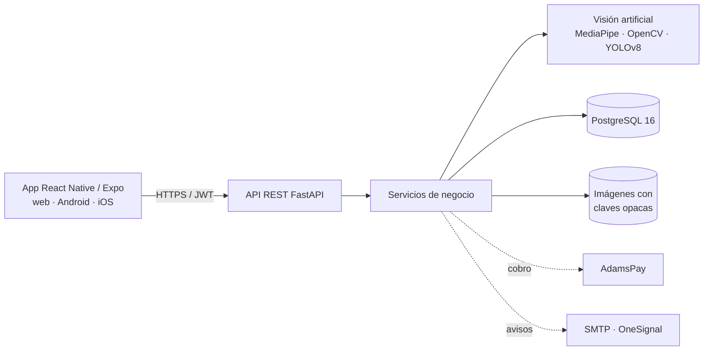

# DermaSeguimiento


Aplicación para el seguimiento fotográfico dermatológico en consultorios independientes. Alinea
automáticamente las fotografías de dos consultas a partir de puntos faciales y cuantifica los cambios de
color de la piel, manchas, textura, ojeras y lesiones de acné, para que el profesional compare con datos
objetivos y entregue al paciente un informe de su evolución.

Proyecto de tesis de Ingeniería Informática de la Universidad de la Integración de las Américas (UNIDA),
Asunción, Paraguay, 2026: *Diseño e implementación de aplicación móvil con OpenCV para trazabilidad del
cuidado dermatológico en consultorios independientes de Asunción, 2026*.

> Los resultados son de apoyo a la documentación clínica y **no constituyen un diagnóstico**. La
> interpretación corresponde siempre al profesional médico.

## Contenido

- [Funcionalidades](#funcionalidades)
- [Identidad de la aplicación](#identidad-de-la-aplicación)
- [Arquitectura](#arquitectura)
- [Tecnologías](#tecnologías)
- [Estructura del repositorio](#estructura-del-repositorio)
- [Instalación](#instalación)
- [Configuración segura](#configuración-segura)
- [Integraciones externas](#integraciones-externas)
- [Pruebas y verificación](#pruebas-y-verificación)
- [Resultados de la validación técnica](#resultados-de-la-validación-técnica)
- [Estado del desarrollo](#estado-del-desarrollo)
- [Autora](#autora)

## Funcionalidades

- **Gestión clínica:** registro de pacientes con consentimiento informado digital, historial cronológico y
  baja de pacientes con motivo.
- **Captura guiada:** óvalo y silueta de la consulta anterior en pantalla; control de luz, enfoque y encuadre
  antes de procesar.
- **Procesamiento de imágenes:** detección de 478 puntos faciales (MediaPipe), alineación afín (OpenCV),
  color en CIE Lab y Delta E por zona, SSIM, manchas, textura (filtro de Frangi), ojeras y detección de
  lesiones de acné con YOLOv8.
- **Resultados:** comparador antes/después con capas y modo parpadeo, resumen en palabras de los cambios,
  gráfico de evolución por indicador y valoración clínica (IGA, mMASI).
- **Informes:** informe de evolución en PDF para el paciente y exportación en CSV.
- **Suscripciones:** plan gratuito y Premium (mensual o anual), cobro con AdamsPay, recibos y avisos de
  vencimiento.
- **Seguridad:** contraseñas con bcrypt, verificación de correo, sesiones revocables, bloqueo por intentos
  fallidos, control de acceso por rol y por propiedad de los datos y auditoría inmutable.
- **Administración:** usuarios y roles, auditoría, configuración de correo y resultados de la escala SUS.

## Identidad de la aplicación

- Nombre visible: `DermaSeguimiento`
- Identificador Android e iOS: `py.dermaseguimiento.app`
- Versión: `1.0.0`
- Plataformas: navegador (web), Android e iOS, a partir del mismo código

## Arquitectura



El procesamiento de imágenes se ejecuta en el servidor; ninguna imagen se envía a servicios externos.

## Tecnologías

| Componente | Tecnología | Versión |
|---|---|---|
| Backend | Python, FastAPI, SQLAlchemy, Alembic, Pydantic | 3.12 · 0.141 · 2.0 · 1.20 · 2.13 |
| Base de datos | PostgreSQL | 16 o superior |
| Visión artificial | OpenCV, MediaPipe Face Landmarker, scikit-image | 5.0 · 1.0 · 0.26 |
| Detección de lesiones | YOLOv8n exportado a ONNX, entrenado con ACNE04 | 8.x |
| Aplicación | React Native, Expo, expo-router | 0.81 · SDK 54 · 6 |
| Informes | reportlab (PDF) | 5.0 |
| Contenedores | Docker y Docker Compose | — |
| Integración continua | GitHub Actions | — |

## Estructura del repositorio

```
Tesis-dermaseguimiento/
├── backend/                  API FastAPI
│   ├── main.py               arranque, manejo de errores y cabeceras de seguridad
│   ├── core/                 configuración, seguridad y sesiones, políticas, límites
│   ├── models/               tablas (usuarios, pacientes, seguimientos, auditoría, pagos…)
│   ├── schemas/              validación de entrada y salida
│   ├── routers/              endpoints por módulo
│   ├── services/             lógica de negocio, visión artificial, pagos, correo y push
│   ├── migrations/           migraciones de Alembic (esquema versionado)
│   ├── scripts/              datos iniciales, validación, prueba piloto y mediciones
│   └── tests/                pruebas automáticas (pytest)
├── dermaseguimiento/         aplicación React Native + Expo Router
├── .github/workflows/        integración continua
└── docker-compose.yml        base de datos y API en contenedores
```

## Instalación

### Requisitos previos

| Herramienta | Versión |
|---|---|
| Python | 3.12 |
| PostgreSQL | 16 o superior |
| Node.js y npm | 20 o superior |
| Android Studio (opcional, app nativa) | con Java 17 |

### 1. Backend

```bash
git clone https://github.com/lujangxnzalezz1/Tesis-dermaseguimiento.git
cd Tesis-dermaseguimiento/backend
python3.12 -m venv venv && source venv/bin/activate      # Windows: venv\Scripts\activate
pip install -r requirements-dev.txt
createdb dermaseguimiento
cp .env.example .env                                     # completar las variables (ver Configuración segura)
alembic upgrade head                                     # crea el esquema
python -m scripts.seed                                   # planes, plantillas de correo y administrador
uvicorn main:app --reload
```

- Documentación interactiva: http://127.0.0.1:8000/docs (Swagger) y http://127.0.0.1:8000/redoc
- Chequeo de disponibilidad: http://127.0.0.1:8000/salud

El modelo de lesiones se copia en `backend/modelos/acne_yolov8n.onnx`. Es opcional: sin él, el sistema
funciona y omite ese análisis.

### 2. Aplicación (navegador)

```bash
cd dermaseguimiento
npm install
cp .env.example .env      # EXPO_PUBLIC_API_URL: dirección del backend
npx expo start --web
```

### 3. Aplicación nativa en Android

```bash
cd dermaseguimiento
npx expo run:android      # requiere Android Studio y un emulador o un celular conectado
```

Desde el emulador, el backend se alcanza con `adb reverse tcp:8000 tcp:8000` o con
`EXPO_PUBLIC_API_URL=http://10.0.2.2:8000`. Desde un celular físico, se usa la IP local de la computadora.

### 4. Contenedores (opcional)

```bash
cp backend/.env.example backend/.env
POSTGRES_PASSWORD=una-clave-fuerte docker compose up --build
```

## Configuración segura

El repositorio no contiene credenciales. Toda la configuración se define con variables de entorno en
`backend/.env` (excluido de Git), a partir de `backend/.env.example`.

| Variable | Uso |
|---|---|
| `DATABASE_URL` | Conexión a PostgreSQL |
| `SECRET_KEY` | Firma de los tokens de sesión |
| `PASARELA` | `adamspay` o `sandbox` (pasarela interna de pruebas) |
| `ADAMSPAY_API_URL`, `ADAMSPAY_API_KEY` | Ambiente y clave de la aplicación de AdamsPay |
| `PASARELA_WEBHOOK_SECRET` | Firma de las notificaciones de la pasarela interna |
| `SMTP_ENABLED`, `SMTP_HOST`, `SMTP_USER`, `SMTP_PASSWORD` | Correo de verificación, recuperación y avisos |
| `VERIFICAR_EMAIL_REGISTRO` | Exige confirmar el correo antes de iniciar sesión |
| `TRIAL_DAYS`, `AVISOS_DIAS_ANTES` | Días de prueba Premium y avisos de vencimiento |
| `ONESIGNAL_APP_ID`, `ONESIGNAL_REST_API_KEY` | Notificaciones push (opcional) |
| `ADMIN_EMAIL`, `ADMIN_PASSWORD` | Administrador inicial |

Para generar claves: `python -c "import secrets; print(secrets.token_urlsafe(48))"`.

## Integraciones externas

- **AdamsPay** (pasarela paraguaya): el sistema crea el cobro, redirige a su página de pago y confirma el
  resultado consultando el estado con la clave de la aplicación. Un pago se aprueba solo si el monto y la
  moneda coinciden con la operación. En el ambiente de pruebas se usa el simulador de AdamsPay.
- **Correo SMTP:** verificación de cuenta, recuperación de contraseña y avisos de pago y vencimiento. Sin
  SMTP configurado, los enlaces se muestran en la consola del servidor.
- **OneSignal:** notificaciones push en la aplicación instalada. Funciona en compilaciones nativas (no en la
  versión web ni en Expo Go) y requiere configurar Firebase (Android) o APNs (iOS) en OneSignal.

Avisos de vencimiento diarios con cron:

```bash
0 9 * * *  cd /ruta/backend && ./venv/bin/python -m scripts.enviar_recordatorios
```

## Pruebas y verificación

```bash
cd backend
pytest                                                     # 217 pruebas automáticas
python -m scripts.validar_alineacion --semisinteticos 50   # validación de la alineación
python -m scripts.medir_rnf foto1.jpg foto2.jpg 10         # tiempo de procesamiento (RNF-06)
```

GitHub Actions ejecuta las pruebas del backend en cada cambio del repositorio.

## Resultados de la validación técnica

| Indicador | Resultado |
|---|---|
| Pares con reducción del error de alineación ≥ 70 % | 43 de 50 (86 %; meta: 80 %) |
| Reducción media del error de alineación | 80,6 % |
| SSIM sobre el rostro | mejora en 48 de 50 pares |
| Tiempo de procesamiento (foto de 12,7 MP) | 3,5 s (meta: ≤ 5 s) |
| Detector de lesiones (ACNE04, YOLOv8n) | mAP@0,5 = 0,292 |

Los datos por par están en `backend/resultados_validacion/validacion_alineacion.csv`.

## Estado del desarrollo

| Fase | Descripción | Estado |
|---|---|---|
| 1 | Configuración del entorno | ✅ Completado |
| 2 | Estructura base del backend | ✅ Completado |
| 3 | Gestión clínica | ✅ Completado |
| 4 | Procesamiento de imágenes y validación (50 pares) | ✅ Completado |
| 5 | Aplicación React Native / Expo | ✅ Completado |
| 6 | Pagos con AdamsPay (ambiente de pruebas) | ✅ Completado |
| 7 | Prueba piloto con dermatólogos (escala SUS) | 🔄 Preparada (`scripts/preparar_piloto.py`) |
| 8 | Despliegue en servidor y pagos en producción | ⏳ Pendiente |

## Autora

**Luján Esmeralda González López**
Ingeniería Informática, Universidad de la Integración de las Américas (UNIDA)
Tutora: Mg. Laura Salinas
Asunción, Paraguay, 2026

Última actualización: octubre de 2026.
